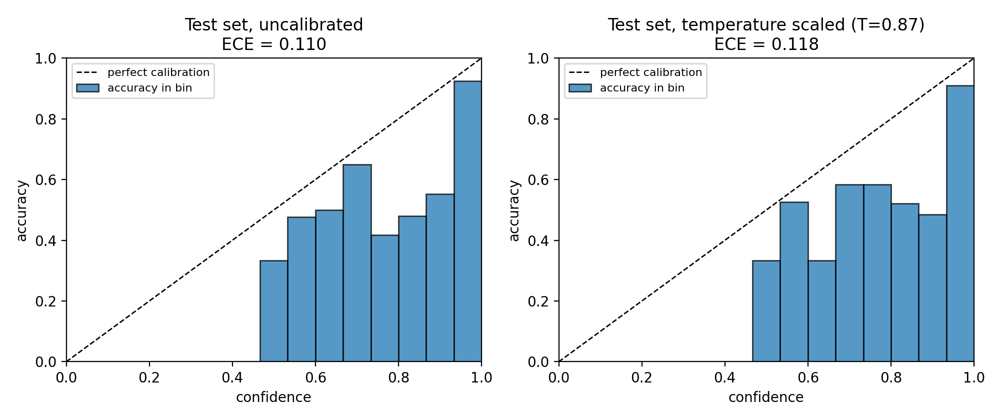
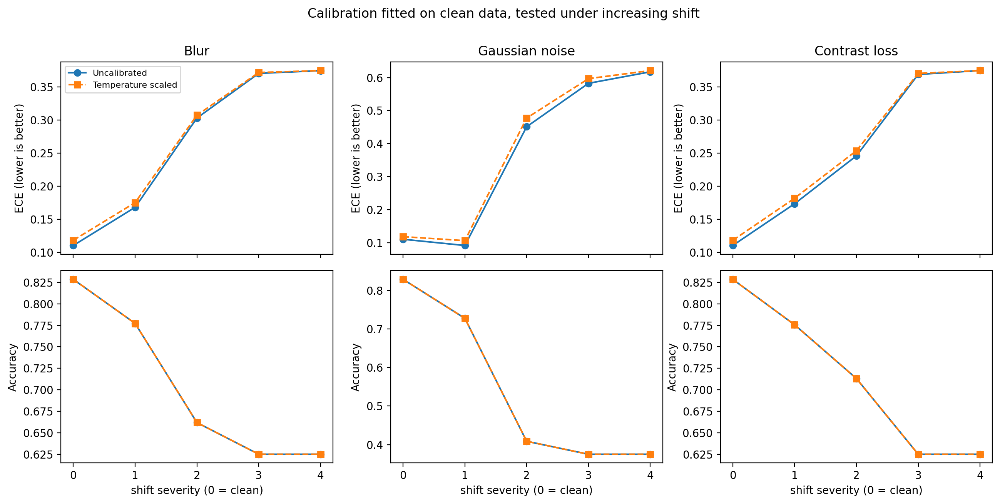

# How far can a chest X-ray classifier's confidence be trusted?

Calibration and distribution shift on PneumoniaMNIST.

## Question

A medical image classifier can be accurate and still badly overconfident. In clinical use, the dangerous case is a wrong answer given with high confidence. This project asks:

1. Is a standard CNN trained on paediatric chest X-rays well calibrated?
2. Does temperature scaling fix it?
3. Does that fix still hold when images shift (blur, noise, contrast loss), as they would between scanners or clinics?

## Method

| Part | Detail |
|---|---|
| Data | PneumoniaMNIST (MedMNIST v2): 5,856 paediatric chest X-rays, 28×28, normal vs pneumonia, official splits |
| Model | 3-block CNN in PyTorch, AdamW, cosine schedule, 15 epochs, best epoch by validation AUC |
| Calibration | Temperature scaling fitted on the validation set |
| Shift | Gaussian blur, Gaussian noise, contrast loss, 4 severity levels each; temperature kept fixed |
| Metrics | Accuracy, AUC, ECE (15 bins), NLL, Brier score |

## Results

| Setting | Accuracy | AUC | ECE | NLL |
|---|---|---|---|---|
| Validation (best epoch) | – | 0.996 | – | – |
| Test, uncalibrated | 0.829 | 0.970 | 0.110 | 0.505 |
| Test, temperature scaled (T = 0.87) | 0.829 | 0.970 | 0.118 | 0.562 |
| Strongest shift (noise 0.2), temperature scaled | 0.375 | – | 0.621 | – |

## Main findings

1. **Strong validation, weaker test.** Validation AUC was 0.996, but test accuracy was 82.9%. The test set has a different case mix (62% pneumonia vs 74% in training and validation), so it already behaves like shifted data.
2. **Confidently wrong.** 52 of 107 test errors were made with over 90% confidence. The worst cases were healthy lungs predicted as pneumonia at near 100% confidence.
3. **Calibration did not transfer.** Temperature scaling fitted on validation made test calibration slightly worse (ECE 0.110 to 0.118, NLL 0.505 to 0.562).
4. **Collapse under shift.** With stronger blur, noise or contrast loss, accuracy fell to 62.5% or 37.5%, which matches predicting a single class for every image, while ECE rose to 0.62. The model stopped using the image but stayed confident.

A single correction learned on one dataset cannot know how unreliable the model becomes on another. That is the core problem for trustworthy clinical AI.

## Limitations

28×28 images; synthetic image corruption rather than real cross-site data; one architecture and one seed; binned ECE is itself a noisy estimate.

## Next steps

- Several seeds with intervals
- Deep ensembles, MC dropout and conformal prediction compared with temperature scaling
- Label-shift-aware recalibration for the case-mix difference
- Real cross-site shift and higher resolution (MedMNIST+ 128/224)

## Run it

Open the notebook (`.ipynb`) in this repository in Google Colab, set Runtime → T4 GPU, and run all (about 1 minute).

## Reference

Yang, J. et al. (2023). MedMNIST v2: A large-scale lightweight benchmark for 2D and 3D biomedical image classification. *Scientific Data*, 10, 41.
